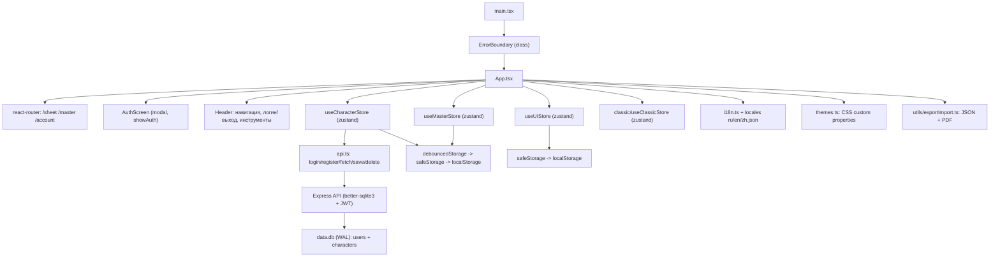
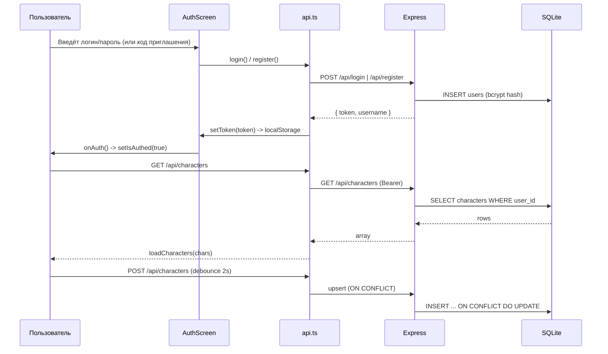

# Архитектура VTM 6E Sheet (лист персонажа)

Одностраничное PWA-приложение на React 18 + TypeScript + Vite. Веб-лист персонажа для **Vampire: The Masquerade 6E**: создание/редактирование нескольких персонажей, история изменений, экспорт JSON/PDF, офлайн-хранилище и синхронизация с сервером.

## 1. Стек и технологии

| Слой | Технология | Назначение |
|---|---|---|
| UI | React 18 + TypeScript + Vite | Компоненты, роутинг, сборка |
| Стили | Tailwind CSS | Базовый layout + CSS custom properties тем |
| Состояние | Zustand (persist → debounced localStorage) | Хранение персонажей, мастера, UI-флагов |
| i18n | i18next + react-i18next | Локализация ru / en / zh |
| Экспорт | html-to-image + jsPDF | PDF-экспорт листов |
| Сервер | Express + better-sqlite3 + JWT (bcrypt) | Бэкенд синхронизации, авторизация |
| Деплой | GitHub Pages, base `/vtm6elist/` | Фронтенд; VDS + nginx — бэкенд |

## 2. Общая архитектура



## 3. Разделение на слои

### 3.1 Точка входа — `src/main.tsx`
- Обёртка в `ErrorBoundary`, рендер `App`.
- Регистрация Service Worker — **только в PROD** (`import.meta.env.PROD`).
- Supabase-sync (`initSync`) отключён: синхронизация идёт через REST API.

### 3.2 Корневая компонента — `src/App.tsx`
Композиция всего UI:
- **State:** `isAuthed`, `showAuth`, `hasMasterCode`, `mobileMenuOpen`, `themeId`, `lang`, `showTips`, `isExporting`, `pdfProgress`.
- **Auth-gate:** жёсткого гейта нет — сайт общедоступен. `AuthScreen` рендерится как **модальное окно** (`showAuth`) по кнопке «Войти».
- **Синхронизация:** при `isAuthed` — pull `api.fetchCharacters()` → `loadCharacters`; push — debounce 2с активного персонажа через `api.saveCharacters`.
- **Роуты:** `/sheet` (SheetPage), `/master` (MasterRoute), `/account` (AccountRoute, gated: без токена — экран с кнопкой «Войти»).
- **Header:** логотип, CharacterSelector, нав-табы, кнопка «Войти»/«Выйти», инструменты (tips, rules, json, import, pdf, язык, тема, меню).

### 3.3 Страницы (lazy-loaded)
| Путь | Компонент | Ответственность |
|---|---|---|
| `/sheet` | `SheetPage` + `SheetPage1..4` + `SheetPageInventory` | Лист персонажа: мета, атрибуты, навыки, дисциплины, история, витэ/воля/ускорение/человечность, предметы/инвентарь |
| `/master` | `MasterRoute` + `MasterPage1..4` | Мастер-лист: кампании, драма, сцены, заметки, NPC |
| `/account` | `AccountRoute` | «Мои персонажи»: сетка N/30, создание/удаление/переключение, экспорт JSON, logout |

## 4. Состояние (Zustand)

Четыре независимых store, каждый с собственным хранением.

| Store | Файл | Persist | Ключи |
|---|---|---|---|
| `useCharacterStore` | `src/store.ts` | debouncedStorage (400ms) | `vtm6e-alpha-storage` |
| `useMasterStore` | `src/masterStore.ts` | debouncedStorage (400ms) | master-sheet |
| `useUIStore` | `src/uiStore.ts` | safeStorage (прямые ключи) | vtm6e-unlock-attrs / -skills / sheet-edition |
| `useClassicStore` | `src/classic/store.ts` | safeStorage | classic-sheet |

### 4.1 useCharacterStore — ядро данных
- Массив персонажей + `activeId` + история изменений.
- **`normalizeCharacter`:** нормализация при загрузке — генерация id, дефолты, clamp чисел, пересборка skills из справочника, миграция legacy (`inventory[]` → `inventoryText`).
- **Auto-fill правила** в `updateMeta`: смена клана → clanBane/beast/rage + синхронизация дисциплин; смена вида → поколение/модификатор; применение life path → +1 навык пути.
- Экспортирует `getActive()`, `loadCharacters()`, `switchCharacter()`, `newCharacter()`, `removeCharacter()`.

### 4.2 useMasterStore
- Кампании (`Campaign`), драма-трекер, scene traits, session notes, NPC-текст.
- CRUD кампаний, обновление драмы, сцены и заметок, `resetMaster`.

### 4.3 useUIStore
- Флаги `unlockAttributes`/`unlockSkills` (разблокировка лимитов), `edition` (`6e`/`20th`).
- Хранится в safeStorage (не через persist middleware).

### 4.4 useClassicStore
- Отдельная модель `ClassicSheetData` (Аттури, Abilities: talents/skills/knowledges, Virtues, Health, Blood Pool) — классический формат листа.

## 5. Данные и справочники (`src/types.ts`)
- Модель `CharacterSheet`: meta, attributes, vitae, willpower, bloodSurge, humanity, skills, resources, items/inventoryText, disciplines, lifePaths, nature/beast/clanTraits/merits/flaws/biography/notes, powerPages.
- Справочники: `SKILLS_LIST`, `CLAN_DATA`, `DISCIPLINES_LIST`, `NATURES`, `VAMPIRE_TYPES`, `CREATION_RULES`, `SIRE_TYPE_TO_DISCIPLINES`.
- Статические данные сил: `src/data/disciplinePowers.ts` (с i18n-ключами); подсказки: `src/data/tooltips.ts`.

## 6. Авторизация и синхронизация



- **Токен:** `localStorage.vtm_token` (JWT, 30 дней).
- **Эндпоинты:** `/api/register`, `/api/login`, `/api/verify-code`, `/api/characters` (GET/POST/DELETE), `/api/health`.
- **API_URL:** DEV → `http://localhost:3001/api`; PROD → `/api` (прокси nginx).
- **Безопасность:** bcrypt (hash), JWT verify на каждом защищённом эндпоинте, invite-code при регистрации, `ON DELETE CASCADE` у characters.

## 7. Экспорт/Импорт (`src/utils/exportImport.ts`)
- **JSON:** `exportJSON(character)` / `importJSONFile(file)` — валидация через `isValidCharacter`.
- **PDF:** `exportAllPDFs(name, onProgress, classicMode)` — рендерит DOM `.sheet-page` через html-to-image → jsPDF. Режим Classic — светлая тема независимо от темы UI.
- Хоткейсы: **Ctrl+S** — JSON, **Ctrl+P** — PDF (через `pdfClassicModeRef`).

## 8. Темы (`src/themes.ts`)
- Массив `{ id, bg, panel, text, muted, accent, border, headerBg, headerText, dotColor, cardBorder, glow, inputBg }`.
- Применяются как CSS custom properties на `document.documentElement`, сохраняются в `vtm6e-theme`.
- Добавление темы = дописать объект в `THEMES` (UI подхватит автоматически).

## 9. Локализация (`src/i18n.ts`)
- i18next, default ru, fallback ru.
- **Ленивая загрузка:** только ru — синхронно; en/zh — `import(`./locales/${lng}.json`)` по запросу в `loadAndChangeLanguage`.
- Ключи по секциям: `ui`, `attributes`, `skills`, `common`, `history`, `pdf`, `resources`, `creation_rules`, `powers`, `auth`, `account`, `nav`, `summary_panel` и др.
- **Правило:** любой пользовательский текст — только через `t('ключ')`; новые строки сразу во все 3 локаля.

## 10. Утилиты хранилища
| Файл | Назначение |
|---|---|
| `src/utils/storage.ts` | `safeStorage` — безопасная обёртка над localStorage (try/catch, null-safe) |
| `src/utils/debouncedStorage.ts` | Debounce-хранилище (400ms) для persist middleware |
| `src/utils/api.ts` | REST-клиент: auth + characters + verifyCode |
| `src/utils/caps.ts` | Вспомогательные утилиты |

## 11. Структура файлов

```
src/
├── App.tsx                 # корневая компонента, роуты, header, auth-modal
├── main.tsx                # вход, ErrorBoundary, SW (PROD)
├── i18n.ts                 # i18next init + lazy locales
├── themes.ts               # темы
├── types.ts                # модели + справочники
├── store.ts                # useCharacterStore
├── masterStore.ts          # useMasterStore
├── uiStore.ts              # useUIStore
├── components/             # AuthScreen, CharacterSelector, SheetPage1-4,
│                           # MasterPage1-4, DotRating, HumanityTracker, Tooltip, ErrorBoundary
├── pages/                  # SheetPage, MasterRoute, AccountRoute
├── classic/                # ClassicPage1/2/ClassicSheetPage + store.ts + types.ts
├── data/                   # disciplinePowers.ts, tooltips.ts
├── hooks/                  # index.ts, useIsMobile.ts
├── lib/                    # supabase.ts, sync.ts (legacy, не вызывается)
├── locales/                # ru.json, en.json, zh.json
└── utils/                  # api.ts, exportImport.ts, storage.ts, debouncedStorage.ts, caps.ts

server/
├── index.js                # Express API + SQLite
├── package.json
├── .env.example
└── README.md
```

## 12. Ключевые принципы
1. **Один источник правды** — Zustand-stores; все мутации через действия.
2. **Общедоступный фронтенд** — логин только для синхронизации и «Мои персонажи»; сам лист работает офлайн.
3. **Нормализация при загрузке** — `normalizeCharacter` гарантирует валидную модель даже для legacy-сейвов.
4. **i18n-чистота** — никакого хардкода языка в компонентах; `defaultValue` — только как фолбэк.
5. **Отдельная модель для каждого режима** — персонаж (6e), мастер, классический лист.
